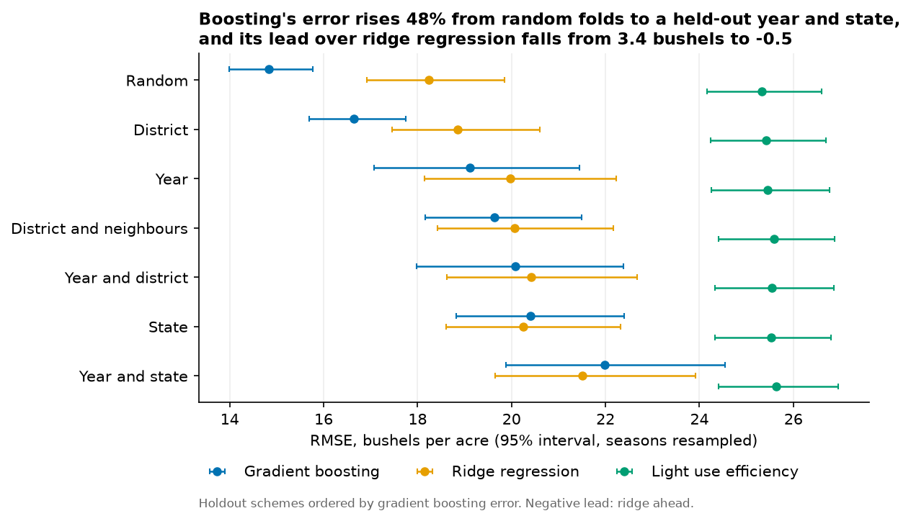
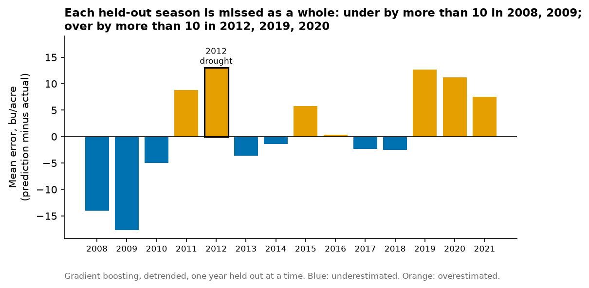
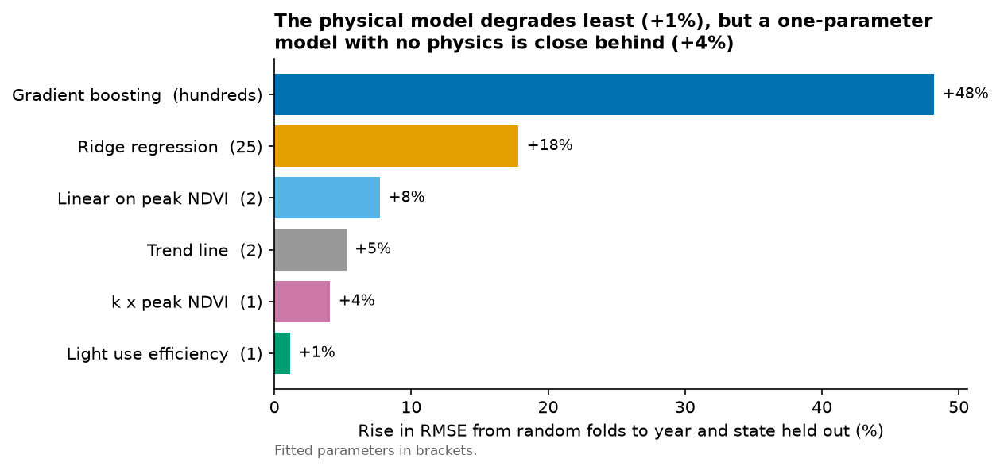
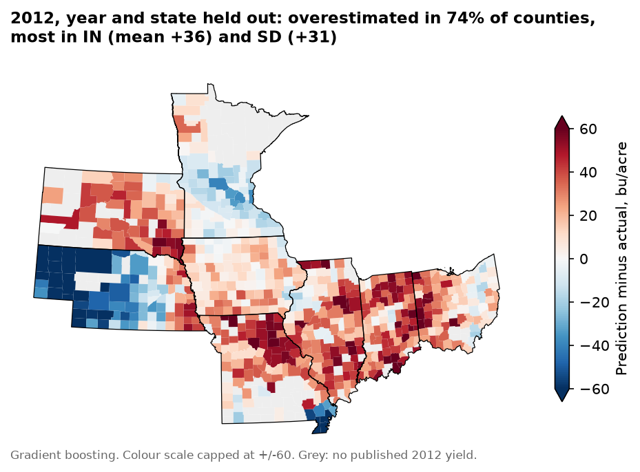
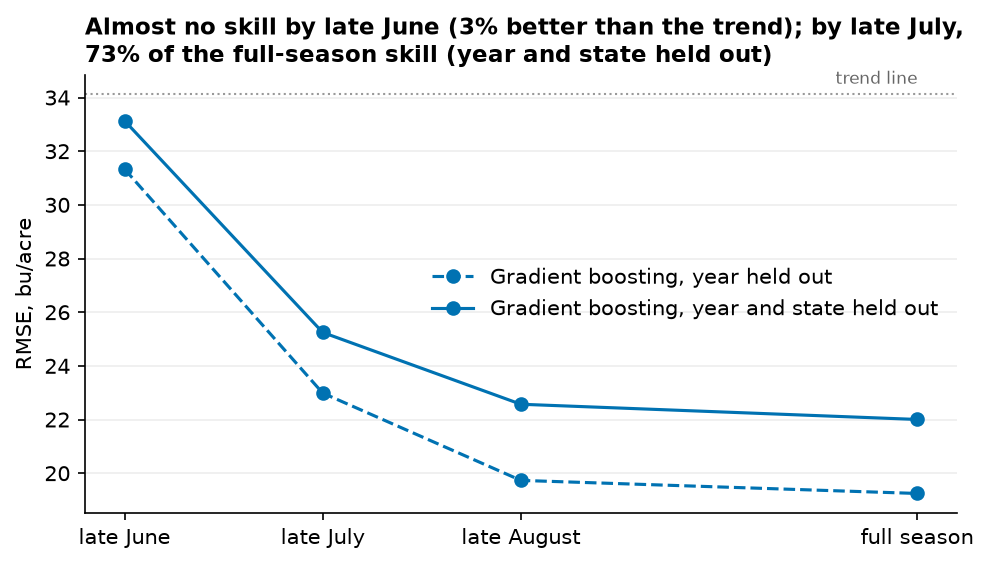
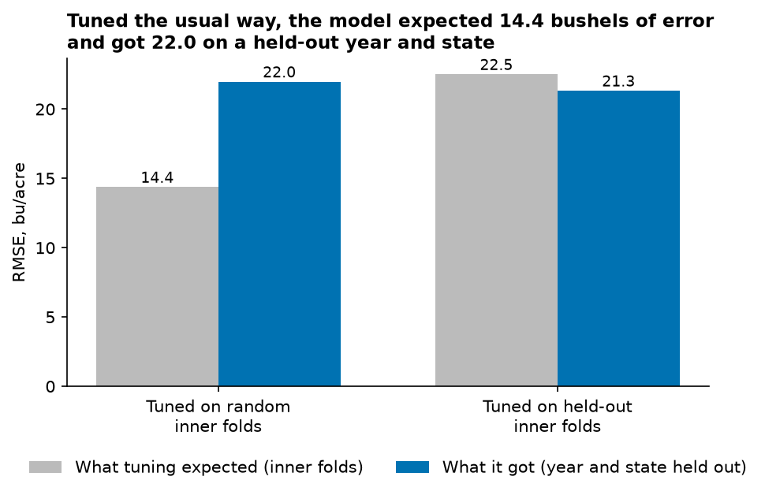
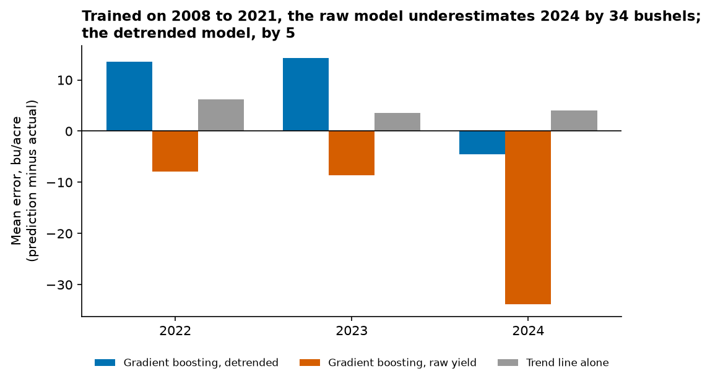
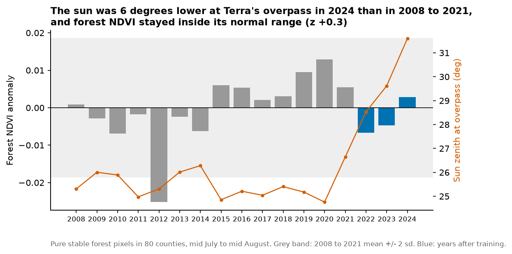

# Predicting county corn yields from satellite time series

US county corn yields from MODIS NDVI, trained on 2008 to 2021 across 721
counties in eight Corn Belt states and tested on 2022 to 2024, three seasons
the models never saw. The project tests how much accuracy a random train-test
split invents, and whether a model with a physical basis transfers to unseen
places better than a flexible one.

Status: **core analysis and out-of-time test complete.** Remaining extensions
are listed at the end.

---

## Findings

All errors are root mean squared error in bushels per acre, against a mean
yield of 161. Brackets are 95% intervals from resampling whole seasons.

1. **A random split understates the error by a third.** Gradient boosting
   scores 14.8 [14.0, 15.8] on random folds and 22.0 [19.9, 24.5] when a whole
   year and a whole state are held out together.
2. **An unseen place is at least as hard as an unseen season, once the spatial
   test stops leaking.** Holding out a single district made space look easy
   (16.6). Excluding the district's neighbours as well raised that to 19.6, and
   holding out a whole state to 20.4, which is harder than an unseen year
   (19.1).
3. **Under strict spatial holdouts, gradient boosting is no better than ridge
   regression.** Boosting wins clearly on random folds (by 3.4). When
   neighbouring districts, a whole state, or a year and a state together are
   held out, the two are indistinguishable.
4. **The light use efficiency model barely degrades when held out, but neither
   does any model with one or two parameters.** Its stability comes from having
   few parameters rather than from its physics, and it is less accurate than
   gradient boosting under every scheme.
5. **The light use efficiency model held up in the 2012 drought, against the
   prediction made before it was run.** It matched gradient boosting there,
   and a one-parameter model on peak NDVI alone did far worse.
6. **Most of the skill is available by late July and nearly all of it by late
   August.** By late June there is almost none.
7. **Removing the yield trend made no difference inside the record and a large
   one beyond it.** Within 2008 to 2021 the two versions were within 0.25
   bushels. Predicting 2022 to 2024, the model trained on raw yield was 4.9
   [2.9, 7.0] worse and underestimated 2024 by 34, because trees cannot
   predict above the yields they were trained on.
8. **Tuned the usual way, the model expected 14.4 bushels of error and got 22.0
   on a held-out year and state.** Tuning on random inner folds picked the
   largest, finest trees allowed in all 37 folds and improved only the random
   score.
   Tuning on held-out inner folds picked small trees, cost 1.5 on the random
   score, and was the only version that improved the held-out one, by 0.6
   [0.1, 1.1].
9. **On three seasons after the training period, the held-out-year estimates
   proved about 10% optimistic.** Gradient boosting scored 21.4 on 2022 to
   2024 against the 19.1 that holding out years had promised, and 23.9 with
   the state held out as well, against 22.0. Both land at or inside the upper
   edge of the earlier intervals.
10. **Terra's drifting orbit has not measurably changed the NDVI.** Over
    pure, stable forest the sun stood 3 to 6 degrees lower at overpass in 2022
    to 2024, and forest NDVI stayed inside its normal year-to-year range. A
    shift larger than about 0.018 would have shown. Forest NDVI also rose over
    2008 to 2021, almost as much as corn's did, so the greening of corn in
    the satellite record cannot be attributed to the crop.

Each is set out with its evidence below.

---

## The question

Most satellite yield models report one accuracy figure from a random split.
Neighbouring counties share weather, soil and management, so a random split puts
near-identical observations on both sides of the fold and the model is partly
recalling neighbours rather than generalising.

A user applying a model to a new season, or to a region with no training data,
is asking a different question from the one a random split answers. So every
model here is scored under seven schemes:

| Scheme | Held out | Folds |
|---|---|---|
| Random | Random fifth of rows | 5 |
| Year | One season | 14 |
| District | One agricultural statistics district (about ten counties) | 71 |
| District and neighbours | A district, with every district touching it removed from training | 71 |
| State | One state | 8 |
| Year and district | One season and one district together | 965 |
| Year and state | One season and one state together | 112 |

Every row is predicted exactly once under every scheme, and every model sees the
same folds, so differences between models are differences between models.

All of this is an end-of-season estimate. Each season's features use that year's
corn map, which USDA publishes the following February, and NDVI through October.
The in-season test below asks what is known earlier.

---

## Data

| Source | What | Period |
|---|---|---|
| USDA NASS Quick Stats | County corn grain yields, bushels per acre | 2008 to 2024 |
| USDA Cropland Data Layer, via the Planetary Computer | Annual corn mask, 30 m | 2008 to 2021 |
| USDA Cropland Data Layer, via Source Cooperative | Annual corn mask, 30 m | 2022 to 2024 |
| MODIS MOD13Q1 (Terra) | NDVI, 250 m, 16-day composites | 2008 to 2024 |
| NASA POWER | Daily shortwave radiation, temperature, rainfall | 2008 to 2024 |
| US Census cartographic boundaries | Counties | 2023 |

2008 to 2021 is the training and cross-validation period. 2022 to 2024 is held
back entirely, for the out-of-time test.

Nothing in `data/` is committed. Every source is public and the scripts in
`src/` rebuild it.

County NDVI is a weighted mean in which each 250 m pixel counts in proportion to
the share of it that the Cropland Data Layer marks as corn that year, using only
pixels MODIS rates as reliable. The masks change every year, so the feature is
NDVI over that year's corn, not over a fixed area.

### Two sources for the corn map

The Planetary Computer's copy of the Cropland Data Layer ends in 2021. For 2022
on, the masks come from Source Cooperative's copy of the full 2008 to 2025
record, an Icechunk Zarr store described as bit-identical to USDA's rasters.

Swapping sources was checked before it was used. 2021 was rebuilt from the new
source for all 742 counties and compared with the original masks. In 671, no
pixel differed by more than 0.01. In the other 71, a few pixels differed, 97% of them outside the county
outline, where no weight is ever applied. The cause was on the original side:
05 cut the corn map at each county's bounding box with no margin, so MODIS
pixels across that edge were averaged from a sliver. Widening the new source's
margin from 60 m to 500 m changed none of the differing pixels. The largest
share of in-county corn weight affected anywhere was 0.031%, which moves a
county's NDVI by well under 0.001. The 2008 to 2021 masks are kept as built so
published results reproduce, and the 2022 to 2024 masks use the margin.

The new store needs icechunk 2, which needs Python 3.12, so it is read from a
separate small environment (`environment-cdl.yml`). Everything else runs in the
main environment, unchanged.

### Terra's drift, and why 2025 is missing

Terra, which carries the MODIS sensor used here, had its last orbit correction
in February 2020 and has drifted to an earlier overpass since. MOD13Q1 records
the sun's zenith angle for each pixel, which rises when the overpass is earlier.
For the late July composite over Story County, Iowa, it held between 28° and 30°
from 2008 to 2022, then rose to 32.0° in 2023 and 35.2° in 2024.

Whether that changes the NDVI was tested directly, under "Has the drift
changed the NDVI?" below. It has not, measurably.

The Planetary Computer's MOD13Q1 stops on 26 June 2025, so there is no 2025
season to test on. NASA's own archive would have it, at the cost of an
Earthdata account, for the most drifted year of all.

### Why MODIS and not Sentinel-2

The Cropland Data Layer on the Planetary Computer stops at 2021 and Sentinel-2
starts in 2017, which leaves five seasons. Yield responds to weather, weather
varies between years, and five years is too few to learn that from. 2012 also
falls outside the window, and it is the most informative season here: mean yield
across these states fell from 143 bushels per acre in 2011 to 111.

At county scale the extra resolution is averaged away over millions of pixels,
and MOD13Q1 arrives composited and cloud-screened where Sentinel-2 needs its own
cloud masking and gap filling. Whether finer imagery helps anyway is a fair
question, and it is the first planned extension.

---

## Models

| Model | Inputs | Fitted parameters |
|---|---|---|
| Gradient boosting (LightGBM) | 14-composite NDVI curve and 10 phenology features | Hundreds |
| Ridge regression | The same 24 features | 25 |
| Light use efficiency, `lue_1` | fAPAR from NDVI, radiation from NASA POWER | 1 |
| k × peak NDVI | Peak NDVI | 1 |
| Linear on peak NDVI | Peak NDVI | 2 |
| Trend line | Year | 2 |

Gradient boosting and ridge predict departures from a linear yield trend fitted
inside each training fold. Hyperparameters are fixed and identical across
schemes. Tuning them on random folds would favour the random scheme, so tuning
is a separate, nested experiment, reported below.

The trend line is the bar to clear. A model that cannot beat a straight line in
year has learned nothing from the satellite.

### The light use efficiency model

Monteith's framework:

```
biomass = RUE x sum(fAPAR x PAR)        over the season
grain   = HI x biomass
```

The physical constants come from the literature rather than from this data:

| Constant | Value | Source |
|---|---|---|
| Radiation use efficiency | 3.8 g dry matter per MJ absorbed PAR | Lindquist et al. 2005, irrigated maize, recommended for yield without growth limits |
| Harvest index | 0.55 | Ruiz et al. 2023, US hybrids released 1983 to 2020, 0.52 to 0.58 |
| PAR share of shortwave | 0.48 | Published ratios run from about 0.41 to 0.50 |

fAPAR follows Sellers et al. (1994): linear in the simple ratio of NDVI, scaled
between the 2nd and 98th percentiles of this dataset's NDVI. Those end members
use NDVI alone and never see a yield. The season runs from composite 4 to 12,
about 9 May to 29 September, chosen from Corn Belt phenology before any model
was run.

Three versions were fitted. `lue_0` uses the literature constants with nothing
fitted. `lue_1` adds one scalar `k`, fitted on each training fold, that absorbs
any constant bias. `lue_2` lets `k` change linearly over time; it improved on
`lue_1` by 0.01 bushels and is not discussed further.

With nothing fitted, the model predicts 207 bushels per acre against an actual
161, and correlates with yield at +0.77. Overprediction is expected, since the
radiation use efficiency is an optimum from irrigated plots. The implied biomass,
19.9 t/ha, is realistic for Corn Belt maize. Fitted on training folds, `k` stays
between 0.76 and 0.77 in all 965 folds of the year and district scheme.

---

## Results

### How much a random split flatters

Gradient boosting, detrended:

| Scheme | RMSE | 95% interval | Share of mean yield |
|---|---|---|---|
| Random | 14.8 | 14.0 to 15.8 | 9% |
| District | 16.6 | 15.7 to 17.8 | 10% |
| Year | 19.1 | 17.1 to 21.4 | 12% |
| District and neighbours | 19.6 | 18.2 to 21.5 | 12% |
| Year and district | 20.1 | 18.0 to 22.4 | 12% |
| State | 20.4 | 18.8 to 22.4 | 13% |
| Year and state | 22.0 | 19.9 to 24.5 | 14% |

The hardest scheme is 48% worse than the random one [39% to 57%].



Much of the error under a held-out year is shared by every county in that
season. With one year held out at a time, the mean error per season runs from
18 bushels under to 13 over:



### Space against time

With only the single-district holdout, an unseen season looked clearly harder
than an unseen place: 19.1 against 16.6, a difference of 2.5 [1.2, 3.8].

That comparison was flattering the spatial side. A held-out district's
neighbours were still in training. Removing them as well cost 3.0 [2.3, 3.8].
Holding out a whole state cost 3.8 [2.9, 4.7] over the district holdout, and
made an unseen state harder than an unseen year by 1.3 [0.5, 2.1].

The earlier conclusion, that temporal leakage matters more than spatial leakage,
was an artefact of a weak spatial test. With an adequate one, place is at least
as hard as season.

### Flexible against linear

| Scheme | Gradient boosting | Ridge | Difference | Clear? |
|---|---|---|---|---|
| Random | 14.8 | 18.2 | -3.4 [-4.2, -2.7] | yes |
| District | 16.6 | 18.9 | -2.2 [-3.0, -1.5] | yes |
| Year | 19.1 | 20.0 | -0.9 [-1.4, -0.3] | yes |
| District and neighbours | 19.6 | 20.1 | -0.4 [-0.9, 0.1] | no |
| State | 20.4 | 20.3 | +0.2 [-0.2, 0.6] | no |
| Year and district | 20.1 | 20.4 | -0.3 [-0.9, 0.2] | no |
| Year and state | 22.0 | 21.5 | +0.5 [-0.1, 1.0] | no |

Gradient boosting's advantage over a linear model sits in the schemes where
neighbouring counties leak. Where they are properly excluded, it disappears.
The extra flexibility is mostly being spent on recognising places it has
effectively already seen.

### Does the physical model transfer better?

The hypothesis written before the model was run: gradient boosting wins on
random folds, and the light use efficiency model degrades less when held out,
because parameters with physical meaning should carry further.

How much worse each model gets from random folds to year and state held out:

| Model | Parameters | Random | Year and state | Ratio |
|---|---|---|---|---|
| Gradient boosting | hundreds | 14.8 | 22.0 | 1.48 [1.39, 1.57] |
| Ridge | 25 | 18.2 | 21.5 | 1.18 [1.14, 1.21] |
| Linear on peak NDVI | 2 | 22.7 | 24.5 | 1.08 [1.07, 1.09] |
| Trend line | 2 | 32.4 | 34.1 | 1.05 [1.04, 1.07] |
| k × peak NDVI | 1 | 27.9 | 29.0 | 1.04 [1.04, 1.04] |
| Light use efficiency | 1 | 25.3 | 25.6 | 1.01 [1.01, 1.02] |



The light use efficiency model does degrade least. But degradation tracks the
number of fitted parameters almost exactly, and models with no physics in them,
one parameter on peak NDVI or a trend line, are nearly as stable. Against its
closest control, k × peak NDVI, the light use efficiency model is 2.5 to 3.4
bushels better in every scheme, but none of those intervals excludes zero.

Its stability is mostly that of a model with one parameter. It also stays less
accurate than gradient boosting everywhere, by 3.6 [1.8, 5.5] even under the
hardest scheme, and a two-parameter line on peak NDVI has lower error than it
under every scheme (not tested as a paired difference).

What the physics does buy is a calibrated scale. With nothing fitted it is
within 28% of observed yields, from published constants alone.

### 2012

Before running it, I expected the light use efficiency model to fail worst in
2012, since it sees greenness and light but not water. It didn't.

| Model, year and state held out | 2012 RMSE | Bias, relative to the model's own average |
|---|---|---|
| Light use efficiency | 31.1 [26.3, 36.1] | +10 |
| Ridge | 32.5 [28.6, 36.4] | +14 |
| Gradient boosting | 33.6 [30.2, 37.0] | +15 |
| k × peak NDVI | 53.6 [47.1, 59.8] | +40 |

These intervals resample districts within the one season, so they describe
spread across places in 2012 rather than uncertainty about droughts in general.



The map shows the overestimate is not uniform. Indiana, South Dakota and
Illinois are overestimated by 29 to 37 bushels on average. Nebraska west
of 99°W is the opposite: 32 counties underestimated by 58 on average. Much of
Nebraska's corn is irrigated, which would keep yields up while the surrounding
landscape browned, and a model trained without Nebraska has seen little of
that. That explanation is a hypothesis; irrigated area per county has not been
added to test it.

The light use efficiency model and both statistical models are indistinguishable
here, and all of them overpredict the drought. The trend line alone overpredicts
2012 by about 49, so the satellite models recover roughly two thirds to four
fifths of the loss. The remainder is consistent with stress around silking
cutting yield before the canopy shows it.

The useful contrast is with k × peak NDVI, a model with the same single
parameter. It is 22 bushels worse in 2012, against about 3 worse across all
years. 2012 had the most radiation of any season here (1,545 MJ/m² against a
typical 1,400, under clear skies) and the lowest fAPAR (0.25 against about
0.38). Absorbed light fell by a quarter. A model that integrates the canopy over
the whole season registered that; a model that looks only at the peak did not.
Whether it is the integration or the physics that matters would need a
one-parameter model on the season's NDVI integral to separate, and that has not
been run.

The 2012 comparison is one season. It shows the light use efficiency model can
cope with a drought, not that it generally copes better.

### What is known before harvest

Gradient boosting refitted using only NDVI up to each cutoff:

| Known by | Year held out | Year and state held out |
|---|---|---|
| Late June (composite 6) | 31.3 | 33.1 |
| Late July (composite 8) | 23.0 | 25.2 |
| Late August (composite 10) | 19.7 | 22.6 |
| Full season | 19.2 | 22.0 |
| Trend line, for comparison | 33.3 | 34.1 |



By late June the model is barely better than the trend line. By late July it has
about three quarters of its full-season skill and by late August nearly all of
it.

The current year's corn map is still used at every cutoff, and it would not
exist yet in practice. Using the previous year's map instead needs the NDVI
extraction rerun and is planned.

### What the model uses

Shuffling groups of correlated features together on the held-out year, and
measuring the rise in RMSE:

| Feature group | RMSE rise |
|---|---|
| NDVI curve, composites 6 to 10 (about 10 June to 28 August) | 12.0 |
| NDVI curve, composites 1 to 5 (late March to early June) | 4.5 |
| Canopy size summaries (peak, mean, integral, amplitude) | 1.7 |
| NDVI curve, composites 11 to 14 | 0.4 |
| Green-up and senescence rates | 0.0 |
| Timing (peak date, start, end) | -0.1 |

Midsummer greenness, through silking and grain fill, carries information nothing
else replaces. The canopy size summaries score low because the curve already
holds what they summarise, which is a property of permutation importance: it
measures what a group adds, not what it contains. The early season matters more
than expected and is not yet explained; planting date, cover crops and other
crops in mixed pixels are all candidates.

### Tuning

Three versions of gradient boosting, scored on the same outer folds:

- **Fixed:** the settings used everywhere else.
- **Tuned on random inner folds:** random search over 16 settings, each judged
  on random folds of the training rows. The usual way.
- **Tuned on held-out inner folds:** the same 16 settings, each judged on inner
  folds that hold out a block of years and a block of states together, copying
  the outer test.

The tuning is nested: inside each outer fold the search sees only that fold's
training rows, and the chosen setting is scored once on outer test rows that
played no part in choosing it. The held-out outer test here deals years into
four interleaved blocks and holds out one state within one block, 32 folds in
all. It is a coarser version of the year and state scheme above, which at 112
folds would have needed about 25,000 fits.

| Outer test | Fixed | Tuned, random inner | Tuned, held-out inner |
|---|---|---|---|
| Random folds | 14.8 | 14.4 | 16.3 |
| Year and state held out | 21.9 | 22.0 | 21.3 |

Paired against fixed: tuning on random inner folds improved the random score
by 0.4 [0.3, 0.6] and changed the held-out score by +0.1 [-0.2, 0.3], nothing
measurable. Tuning on held-out inner folds made the random score worse by 1.5
[1.2, 1.8] and the held-out score better by 0.6 [0.1, 1.1]. The ranking of the
three versions reverses between the two tests.

What each chose explains it. Tuned on random inner folds, the search picked the
same setting in all 37 outer folds: 127 leaves with a minimum of 5 rows per
leaf, the largest and finest trees the search space allowed. Tuned on held-out inner folds, the median choice was 7 to 15
leaves with a slower learning rate. Random inner folds reward trees fine enough
to recognise individual neighbourhoods.

The larger problem is the estimate that tuning reports:



Tuned the usual way, the inner folds put the error at 14.4. On a held-out year
and state it was 22.0, 53% higher. Tuned on held-out inner folds, the inner
estimate was 22.5 against an actual 21.3, slightly pessimistic, which is the
safer direction to be wrong in.

The gain from tuning properly is small, 0.6 bushels. The case for doing it is
less about that gain than about the number reported at the end of tuning,
which is only trustworthy if the inner folds ask the same question as the
outer ones.

### Detrending

Yields rise 2.9 bushels per acre per year across this period. Removing a fitted
trend before modelling changed RMSE by 0.0 to 0.25 bushels under every scheme,
with every interval spanning zero. The trend alone explains about 11% of the
variance, since most variation is between counties rather than years.

An earlier draft added that corn NDVI rises over the period (season APAR from
about 480 MJ/m² in 2008 to 560 to 580 from 2016 on), so NDVI already carries
the trend. The forest test below undercuts that: forest NDVI rose over the same
years, by more than half as much, so the rise cannot be credited to the crop.

Either way, that conclusion holds only inside the record. The next section shows
it reversing once the model has to predict beyond it.

### Seasons the model never saw

Every model was trained on 2008 to 2021 and asked to predict 2022 to 2024, which
it had never seen. Two schemes: every county, and each state predicted by
models trained on the other seven. NASS published fewer county estimates each
year (613, 570 and 487 county-years), so later years rest on fewer counties.

Three test seasons are too few to resample, so the intervals below resample
districts within each season. They describe spread across places, not
uncertainty about future seasons in general.

| Model | Every county | State held out | Mean error, every county |
|---|---|---|---|
| Gradient boosting, detrended | 21.4 [19.5, 23.3] | 23.9 [21.8, 26.2] | +8.5 |
| Ridge regression | 23.1 [21.1, 25.2] | 24.3 [22.1, 26.5] | +10.5 |
| Linear on peak NDVI | 26.0 [23.7, 28.4] | 27.6 [24.8, 30.8] | -14.0 |
| Gradient boosting, raw yield | 26.3 [24.7, 27.9] | 28.7 [26.9, 30.7] | -15.7 |
| Light use efficiency | 27.2 [24.8, 29.7] | 27.4 [25.0, 29.9] | -8.4 |
| k × peak NDVI | 31.0 [29.1, 32.8] | 31.7 [29.8, 33.7] | -16.7 |
| Trend line | 32.0 [29.1, 35.0] | 33.3 [30.4, 36.4] | +4.6 |

**The earlier estimates mostly held.** Holding out years inside the record put
gradient boosting at 19.1 [17.1, 21.4]; on the future it scored 21.4, at the top
of that interval. Holding out a year and a state put it at 22.0 [19.9, 24.5]; on
the future with the state held out it scored 23.9, inside the interval. The
held-out-year scores were about 10% optimistic, a much smaller gap than the one
between random folds and either.

**Detrending decides the future.** Inside the record it made no measurable
difference. Here the raw model is 4.9 [2.9, 7.0] worse, and its error grows each
year as yields keep rising past anything it was trained on:



A tree predicts the average of training yields that fell in a leaf, so it can
never predict above the highest yields it saw. The detrended model predicts
departures from a trend line and lets the line carry the level forward. Every
model without a trend term underestimates the future (light use efficiency by
8, the peak NDVI models by 14 to 17). Peak NDVI in 2022 to 2024 (0.852 to
0.862) was no higher than in 2019 to 2021 (0.857) while yields kept rising, so
the canopy alone did not carry the rise forward.

**The trend line overshot.** Extended from 2008 to 2021, it put 2022 to 2024 at
183, 186 and 189; the counties NASS reported came in at 177, 182 and 185. The
detrended gradient boosting model overestimated 2022 and 2023 by about 14, more
than the trend line did, and underestimated 2024 by 5. Why 2022 and 2023 ran
high is not established.

**No sign of the drift in the errors.** The sun zenith angle at Story County
jumped from 29° in 2022 to 32° in 2023, and the detrended model's bias barely
moved (+13.6 to +14.3). 2024, the most drifted year, had its lowest error
(18.1). Weather differs between seasons too, so errors alone cannot settle it.
The direct test is the next section.

### Has the drift changed the NDVI?

Corn cannot answer this, because the crop changes every year. Forest mostly
does not. So the test follows NDVI over forest that stayed forest:

- **Pixels.** 250 m pixels at least 90% forest in both the 2008 and 2021
  Cropland Data Layer, judged at 30 m before averaging (classes 63 and 141 to
  143). Requiring both years removed 16.9% of the pure forest pixels: stands
  cleared in between, and pixels the two maps simply classify differently.
- **Counties.** The 80 with the most such pixels: 41 in Missouri, 20 in Ohio,
  9 in Indiana, 5 in Minnesota, 3 in South Dakota and 2 in Illinois.
- **Measure.** Mean NDVI of reliable pixels in the two midsummer composites
  (about 12 July to 12 August), as an anomaly from each county's 2008 to 2021
  mean, averaged across counties for each year.



Over these forests the sun zenith angle at overpass averaged 25.5° from 2008
to 2021, never above 26.6°. It was 28.5° in 2022, 29.6° in 2023 and 31.6° in
2024. Forest NDVI in those years was 0.7, 0.5 and 0.3 standard deviations from
the 2008 to 2021 mean, the first two below and the last above, all well inside
the normal range. The one year that falls outside it is 2012, the drought. In
these forests the weather moves NDVI more than the overpass change has.

The test has limits. Forest NDVI varies by about ±0.018 (two standard
deviations) from year to year, so a shift smaller than that would not show.
In a pooled linear fit, 0.01 of peak NDVI is worth about 5 bushels of corn, so
a drift effect of a few bushels cannot be ruled out. Forest and crop canopies
also differ in structure, and a drift effect on one need not equal the effect
on the other.

**The forest greened too.** Over 2008 to 2021 forest NDVI rose 0.0013 a year
[0.0006, 0.0025], against 0.0023 [0.0011, 0.0050] for corn peak NDVI, both
with intervals from resampling years. The difference, 0.0010 [-0.0001, 0.0027],
is not distinguishable from zero, and forest and corn NDVI move together from
year to year (correlation 0.88). Whatever raised corn NDVI over the period,
whether weather, the sensor or something regional, raised forest NDVI nearly as
much. A first version of this test used forest from the 2021 map alone and gave
nearly identical results: the same forest trend to within 0.0001 a year, and
the same 2022 to 2024 z-scores to within 0.03.

**Flexible against linear, again.** With every county predicted, gradient
boosting beat ridge by 1.8 [0.8, 2.8]. With each state held out, the two were
indistinguishable (0.4 [-0.8, 1.6]), as they were under every strict spatial
holdout inside the record.

**The light use efficiency model's edge over its control became measurable.**
Inside the record it was 2.5 to 3.4 bushels better than k × peak NDVI and never
clearly so. On the future it was 3.8 [0.6, 6.9] better with every county and
4.4 [1.1, 7.5] with the state held out. Integrating absorbed light over the
season held up beyond the record better than the single peak did. It still
trails gradient boosting by 3.5 to 5.8.

---

## Corrections made along the way

Kept here because each one changed a number.

- **Leap years.** Searching 1 April to 31 October catches a fifteenth composite
  only in leap years. Left in, it would have added an extra value to every leap
  year's season integral, and 2012 is a leap year. Every year is now cut to the
  same fourteen composites.
- **The spatial holdout.** The first spatial test let neighbouring districts
  leak into training and produced a conclusion about space and time that a
  stronger test reversed.
- **Reproducibility.** The same seed gave slightly different trees on two
  machines, because LightGBM's multithreaded sums depend on thread timing. A
  fixed thread count and deterministic mode now make reruns identical, and the
  robustness script refits one scheme and stops if it does not match.
- **The harvest index.** First set to 0.50, below the published range for these
  hybrids, then corrected to 0.55 from Ruiz et al. (2023). That changes only the
  uncalibrated model.
- **Duplicate composites.** The Planetary Computer catalogue lists 2021's 14
  September composite three times, so every county got three identical rows for
  that date. Rebuilding the features without them changed no model feature
  (largest difference 0.0). 06 now keeps one item per date, and 07 stops if
  duplicates ever disagree.
- **The mask edge.** The original masks cut the corn map at the county's
  bounding box with no margin. Measured when the second source was checked, it
  affects at most 0.031% of a county's corn weight, and is described under
  "Two sources for the corn map".

---

## Limits

- **End-of-season, current-year mask.** Covered above.
- **Radiation is coarse.** NASA POWER's shortwave comes from a 1 degree grid, so
  722 counties share 140 distinct radiation series. County differences in the
  light use efficiency model come mostly from fAPAR.
- **Mixed pixels.** A 250 m pixel is 5.4 ha and seldom all corn. Corn weighting
  reduces the dilution from other crops without removing it.
- **Small search.** Tuning tried 16 settings with 3 inner folds. A larger
  search could find more, though the direction of the result is unlikely to
  change given how consistently each kind of tuning chose.
- **Counties with published yields only.** NASS withholds county estimates where
  too few farms report, and those counties are not random.

---

## Planned extensions

### Does 10 metre imagery predict yield any better?

2017 to 2021 is covered by both MODIS and Sentinel-2:

> Holding everything else constant, does a Sentinel-2 feature set predict county
> corn yield better than a MODIS one?

The case for yes is that 10 metre pixels resolve fields, so fewer mixed pixels
dilute the signal. The case for no is that county averaging removes what the
finer grid resolved, and cloud-limited revisits give a worse time series than
MODIS composites.

**Iowa only, 99 counties.** Sentinel-2 needs cloud masking from its scene
classification layer and compositing onto a regular interval before it is
comparable, which across eight states is a very large job. Iowa has the cleanest
corn signal, and MODIS is rescored on exactly the same subset.

**The crop mask is 30 m until 2023.** In 2017 to 2021 any Sentinel-2 advantage
comes from the vegetation signal, not from sharper crop boundaries. USDA moved
the Cropland Data Layer to 10 m from 2024, built partly from Sentinel-2, so
repeating the comparison on 2024 and 2025 tests the sharper-mask argument
directly. Two seasons is too few to train on, so those years are used for
evaluation only.

### A drift test with an independent sensor

The forest test can only see shifts larger than about 0.018 NDVI. Comparing
MODIS with VIIRS over the same corn pixels, before and after 2022, could detect
smaller ones, using an independent sensor with its own orbit history.

### 2025, and after Terra

A 2025 season needs MOD13Q1 from NASA's archive rather than the Planetary
Computer. NASA plans to wind down Terra and Aqua from late 2026 and points users
to VIIRS. Moving the pipeline to VIIRS is the natural next step and is out of
scope here.

### Smaller ones

- A previous-year crop mask, for a true in-season test.
- An in-season light use efficiency model that adds expected radiation for the
  rest of the season.
- A one-parameter model on the season NDVI integral, to separate integration
  from physics in 2012.

---

## Setup

```
conda env create -f environment.yml
conda activate cropyield
```

A free NASS Quick Stats API key is needed, from
<https://quickstats.nass.usda.gov/api>. Put it in `.env`:

```
NASS_API_KEY=your_key_here
```

### Pipeline

| Script | Does | Runtime |
|---|---|---|
| `00_probe_nass.py` | One request, to inspect the response (optional) | seconds |
| `01_fetch_yields.py` | County corn grain yields | minutes |
| `02_fetch_boundaries.py` | County boundaries | minutes |
| `03_probe_rasters.py`, `03b_probe_satellites.py` | Check collections and assets (optional) | minutes |
| `04_probe_extraction.py` | One county end to end, the reference result (optional) | minutes |
| `05_build_corn_masks.py` | Corn fraction per MODIS pixel, every county-year | about 8 hours |
| `05b_verify_masks.py` | Check the masks against the probe (optional) | seconds |
| `06_extract_ndvi.py --all` | Corn-weighted NDVI per county and composite | about 11 hours |
| `07_features.py` | Curve and phenology features, joined to yields | about a minute |
| `08a_probe_power.py` | One NASA POWER request (optional) | seconds |
| `08_fetch_radiation.py` | Daily radiation and weather per county | about 30 minutes |
| `09_baseline_gbm.py` | Gradient boosting under four schemes | about 22 minutes |
| `10_lue_model.py` | Light use efficiency model and comparison | seconds |
| `11_robustness.py` | Stronger holdouts, controls, intervals, in-season, importance | about 8 minutes |
| `12_figures.py` | The figures in this README | seconds |
| `13_tuning.py` | Nested tuning, three versions compared | about 45 minutes |

For the out-of-time test, after the above:

| Command | Does | Runtime |
|---|---|---|
| `python src/14a_probe_recent.py` (cdl environment) | Check the second corn map source and Terra after 2021 (optional) | minutes |
| `python src/14_build_masks_recent.py --verify-all` (cdl environment) | Rebuild 2021 from the second source and compare every county (optional) | about 30 minutes |
| `python src/14_build_masks_recent.py` (cdl environment) | Corn masks 2022 to 2024 | about 2 hours |
| `python src/06_extract_ndvi.py --years 2022-2024` | NDVI 2022 to 2024 | about 2.5 hours |
| `python src/01_fetch_yields.py --years 2022-2024 --out data/nass_corn_yields_recent.csv` | Yields 2022 to 2024, with a check for revisions | about a minute |
| `python src/08_fetch_radiation.py --recent` | Radiation 2022 to 2024 | about 25 minutes |
| `python src/07_features.py --years 2022-2024 --yields data/nass_corn_yields_recent.csv --out data/model_table_recent.parquet` | Features 2022 to 2024 | about a minute |
| `python src/15_out_of_time.py` | Train on 2008 to 2021, predict 2022 to 2024 | seconds |
| `python src/16_drift_check.py` | Forest NDVI 2008 to 2024, testing Terra's drift | about 2.5 hours |

The cdl environment is created with `conda env create -f environment-cdl.yml`.

`12_figures.py` draws the tuning and out-of-time figures once `13_tuning.py`
and `15_out_of_time.py` have run.

Scripts 05 and 06 save as they go and skip finished years when rerun. Every
script prints progress and writes a log to `logs/`.

---

## References

- Lindquist, J.L., Arkebauer, T.J., Walters, D.T., Cassman, K.G. and Dobermann, A.
  (2005). Maize radiation use efficiency under optimal growth conditions.
  *Agronomy Journal* 97, 72 to 78.
- Monteith, J.L. (1977). Climate and the efficiency of crop production in
  Britain. *Philosophical Transactions of the Royal Society B* 281, 277 to 294.
- Roberts, D.R. et al. (2017). Cross-validation strategies for data with
  temporal, spatial, hierarchical, or phylogenetic structure. *Ecography* 40,
  913 to 929.
- Ruiz, A. et al. (2023). Harvest index has increased over the last 50 years of
  maize breeding. *Field Crops Research*.
- Sellers, P.J., Los, S.O., Tucker, C.J., Justice, C.O., Dazlich, D.A., Collatz,
  G.J. and Randall, D.A. (1994). A global 1 by 1 degree NDVI data set for climate
  studies. Part 2. *International Journal of Remote Sensing* 15, 3519 to 3545.
